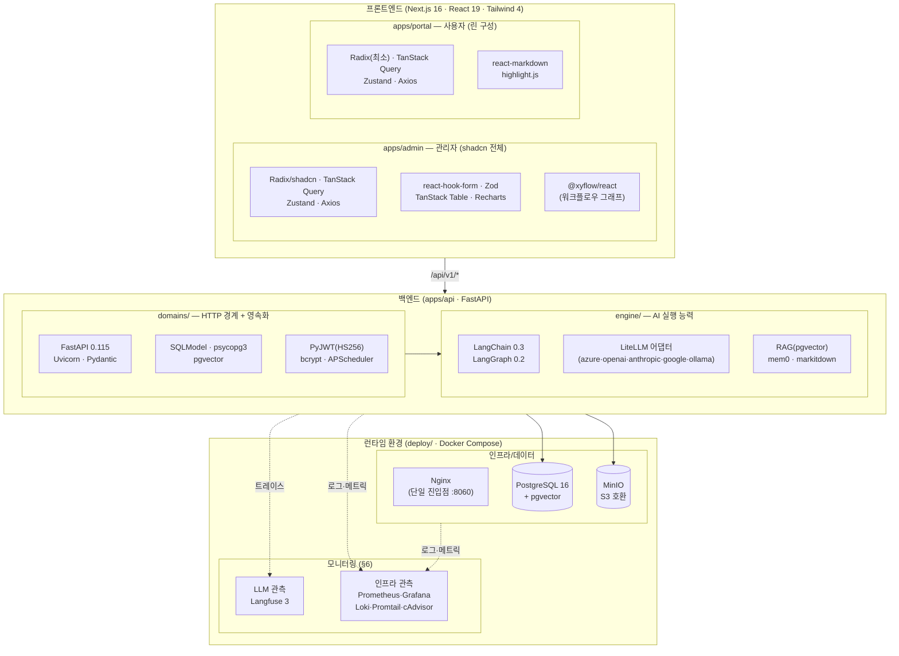
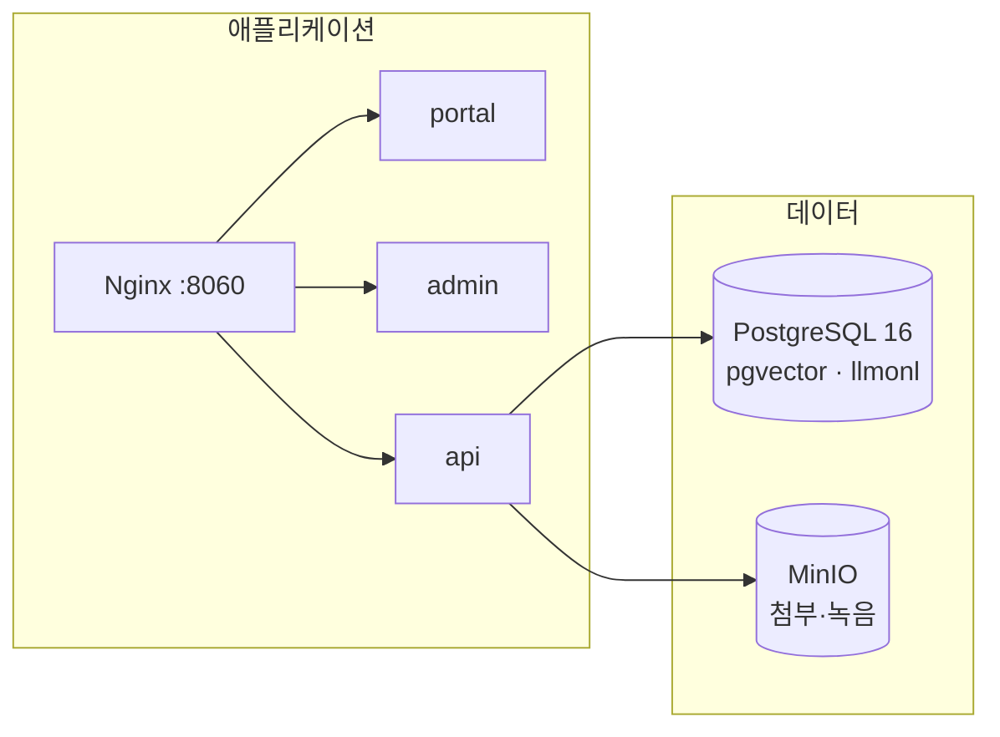
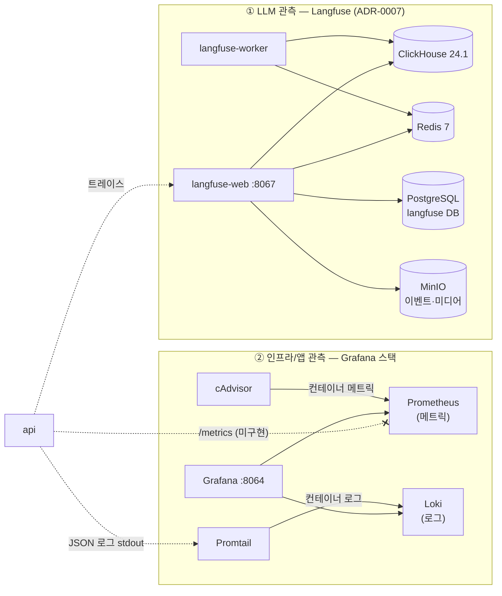

# 개발 스택 (Development Stack)

> orchestration-v3가 **무엇으로 만들어져 있는지**(언어·프레임워크·라이브러리·인프라·툴체인)를 1장으로 요약한다. "어떻게 구성·동작하는지(토폴로지·레이어·도메인)"는 [`architecture.md`](architecture.md), "왜 그렇게 했는지"는 [`adr/`](adr/).
>
> - 이 문서는 **living doc** — 의존성이 바뀌면 갱신한다. 버전은 `apps/*/pyproject.toml`·`package.json`·`deploy/docker-compose.yml` 기준(명시 범위의 하한).
> - 최종 갱신: 2026-11-25

---

## 1. 스택 전경 (레이어별)

## 2. 백엔드 (`apps/api` — Python 3.13 / FastAPI)

> 레이어 의존은 단방향 `domains → engine → core`. `import-linter`가 강제(§5). — [ADR-0005](adr/0005-ai-engine-layer.md)

| 구분 | 기술 | 용도 | 근거 ADR |
|------|------|------|----------|
| 런타임 | **Python 3.13** | — | — |
| 웹 프레임워크 | **FastAPI** ≥0.115 · **Uvicorn** ≥0.32 | HTTP 경계·ASGI 서버 | — |
| 검증/설정 | **Pydantic** · pydantic-settings | 스키마·env 로딩 | [0018](adr/0018-env-config-layout.md) |
| ORM/DB | **SQLModel** ≥0.0.22 · **psycopg3**(pool) · **pgvector** | 관계형 영속화 + 벡터 | [0012](adr/0012-engine-rag.md) |
| 인증 | **PyJWT**(crypto, HS256) · **bcrypt** | ID/PW 검증·JWT 발급 | [0009](adr/0009-self-id-password-auth.md) |
| 스케줄러 | **APScheduler** ≥3.10 | 워크플로우 cron 트리거 | [0019](adr/0019-workflow-engine.md) |

### AI 엔진 (`engine/` — DB·HTTP 비의존)

| 엔진 라이브러리 | 기술 | 용도 | 근거 ADR |
|------|------|------|----------|
| LLM 오케스트레이션 | **LangChain** ≥0.3 · **LangGraph** ≥0.2 | 그래프 실행·HITL interrupt | [0008](adr/0008-chat-human-approval.md)·[0011](adr/0011-chat-streaming-contract.md) |
| 체크포인터 | langgraph-checkpoint-postgres ≥2.0 | HITL/중단 세션 내구화 | [0028](adr/0028-langgraph-postgres-checkpointer.md) |
| LLM 공급자 추상화 | **langchain-litellm** ≥0.2 | azure·openai·anthropic·google·ollama | [0010](adr/0010-engine-llm-provider.md) |
| 관측 | **langfuse** ≥3 | 트레이스·토큰·비용 | [0007](adr/0007-llm-observability-langfuse.md) |
| 장기 메모리 | **mem0ai** ≥1.0 (+ azure-identity) | pgvector 기반, opt-in | [0015](adr/0015-long-term-memory.md) |
| 객체 스토리지 | **minio** ≥7.2 | 첨부·회의 녹음(S3 호환) | [0017](adr/0017-attachment-object-storage-minio.md) |
| 문서 추출 | **markitdown**[pdf,docx,pptx,xlsx] | PDF·Office → markdown | [0016](adr/0016-document-text-extraction.md) |
| 웹 검색 | langchain-community · **ddgs** | 워크플로우 tool 노드(DuckDuckGo) | [0019](adr/0019-workflow-engine.md) |

## 3. 프론트엔드 (`apps/admin` · `apps/portal` — Next.js / React)

> `admin`은 shadcn-admin 전체 구조, `portal`은 린 구성(shadcn 미복제). — [ADR-0006](adr/0006-web-structure-and-oidc.md)·[ADR-0020](adr/0020-user-portal-frontend.md)

| 구분 | 기술 | admin | portal |
|------|------|:---:|:---:|
| 프레임워크 | **Next.js 16** · **React 19** · TypeScript 5.9 | ✅ | ✅ |
| 스타일 | **Tailwind CSS 4** · tw-animate | ✅ | ✅ |
| UI 컴포넌트 | **Radix UI** / shadcn · lucide-react | ✅(전체) | ✅(최소) |
| 서버 상태 | **TanStack Query 5** · **Axios** | ✅ | ✅ |
| 클라이언트 상태 | **Zustand 5** | ✅ | ✅ |
| 폼/검증 | react-hook-form · **Zod 4** | ✅ | — |
| 테이블/차트 | TanStack Table · Recharts | ✅ | — |
| 그래프 에디터 | **@xyflow/react**(워크플로우 노드) | ✅ | — |
| 마크다운 | react-markdown · remark-gfm · highlight.js | ✅ | ✅ |
| 로깅 | pino | ✅ | — |

- **타입 계약**: `packages/contracts`가 api OpenAPI → TS를 **단방향** 생성(`openapi-typescript`, `task gen-types`). 생성물은 커밋 안 함.
- **응답 래퍼**: 모든 응답은 `ApiResponse[T]` → axios 인터셉터가 `data` 자동 unwrap.

## 4. 인프라/데이터 (`deploy/` — Docker Compose + Nginx)

> 애플리케이션 구동과 데이터 영속화 계층만. 관측·로그·메트릭 스택은 **§6 모니터링**에서 분리해 다룬다.

| 서비스 | 이미지 | 역할 | 로컬 포트 |
|--------|--------|------|:---:|
| **Nginx** | nginx:alpine | 단일 진입점 리버스 프록시 | 8060 |
| **PostgreSQL** | pgvector/pgvector:pg16 | 메인 DB(`llmonl`) + 벡터 + Langfuse DB | 8066 |
| **MinIO** | minio/minio | S3 호환 객체 스토리지(첨부·회의 녹음) | 8068(콘솔) |

- **env 단일 소스**: `deploy/environments/<env>/{compose.env, api.env}`에만. — [ADR-0018](adr/0018-env-config-layout.md)

## 5. 툴체인 (개발·빌드·품질)

| 영역 | 도구 | 비고 |
|------|------|------|
| 모노레포 태스크 | **go-task**(Taskfile.yml) | `task dev`·`lint`·`test`·`gen-types`·`deploy` |
| Python 의존성 | **uv** | `uv sync --group dev` |
| Python 태스크 | **poethepoet**(poe) | `poe dev`·`lint`·`format`·`test` |
| Python 린트/포맷 | **ruff** ≥0.7 | `E·F·I·UP·B`, line-length 100 |
| 레이어 경계 | **import-linter** ≥2.1 | `domains→engine→core` 단방향 강제 + engine은 FastAPI 비의존 |
| Python 테스트 | **pytest** ≥8.3 | `tests/`(health·HITL 정책·artifact 파서) |
| JS 패키지 매니저 | **pnpm** 9.15 | 양 프론트 공통 |
| JS 린트/포맷 | **ESLint 9** · **Prettier 3** · knip | typescript-eslint · import 정렬 |
| 배포 | **Docker Compose** + `tools/deploy.py` | `task deploy ENV=<local\|dev\|stg\|prd>` |

> ⚠️ uv·ruff·pnpm은 Claude 셸 PATH에 없을 수 있음 — lint/test/build는 사용자가 직접 실행.

## 6. 모니터링 (관측 스택)

> 모니터링은 **두 축으로 분리**돼 있다 — ① LLM 동작 관측(Langfuse), ② 인프라/애플리케이션 관측(Grafana 스택). 성격·대상·저장소가 다르므로 별도로 운영한다.

### ① LLM 관측 — Langfuse (ADR-0007)

LLM 호출의 트레이스·토큰·비용·지연을 추적. 계측은 `engine/observability`, 컨텍스트 값은 도메인이 주입(엔진 경계 준수). lifespan 종료 시 flush.

| 서비스 | 이미지 | 역할 | 로컬 포트 |
|--------|--------|------|:---:|
| **Langfuse** (web+worker) | langfuse/langfuse:3 | LLM 트레이스·비용 UI + 비동기 수집 | 8067 |
| ClickHouse | clickhouse-server:24.1 | 트레이스 분석 스토어 | — |
| Redis | redis:7-alpine | 수집 큐 | — |

- 저장소: 전용 `langfuse` DB(PostgreSQL 공유) + ClickHouse + MinIO(이벤트·미디어·export 버킷).
- 근거: [ADR-0007](adr/0007-llm-observability-langfuse.md).

### ② 인프라/애플리케이션 관측 — Grafana 스택

컨테이너 리소스·메트릭·애플리케이션 로그를 Grafana 한 곳에서 조회(V2 계승).

| 서비스 | 이미지 | 역할 | 로컬 포트 |
|--------|--------|------|:---:|
| **Grafana** | grafana/grafana | 메트릭·로그 통합 대시보드 | 8064 |
| Prometheus | prom/prometheus | 메트릭 수집·저장 | — |
| Loki | grafana/loki:3.0 | 로그 저장(label 인덱스) | — |
| Promtail | grafana/promtail:3.0 | 컨테이너 로그 수집 | — |
| cAdvisor | gcr.io/cadvisor | 컨테이너 리소스 메트릭 | — |

- **메트릭(Prometheus)**: 현재 scrape 대상은 **cadvisor(컨테이너 리소스)와 prometheus 자신**뿐. `prometheus.yml`에 `api:8000/metrics` job이 정의돼 있으나 **api가 아직 `/metrics`를 노출하지 않아 비활성**(주석 "관측 미들웨어 이식 시 활성화"). 앱 레벨 메트릭은 이식 대기.
- **로그(Loki)**: 로그는 메트릭 경로와 무관하게 이미 수집됨 — docker는 `LOG_FORMAT=json`(ADR-0031) → Promtail json stage가 `level·logger·request_id`를 필드로 파싱 → Loki 쿼리. `request_id`는 미들웨어가 contextvar로 자동 주입.
- Grafana 대시보드 프로비저닝: `deploy/grafana/dashboards/json/*`(application_load·db_cache·infrastructure·logs).

---

### 관련 문서
- [`architecture.md`](architecture.md) — 현행 아키텍처(토폴로지·레이어·도메인 현황)
- [`structure-and-references.md`](structure-and-references.md) — 구조가 외부 표준과 어떻게 정렬되는지
- [`adr/README.md`](adr/README.md) — 설계 결정 이력
